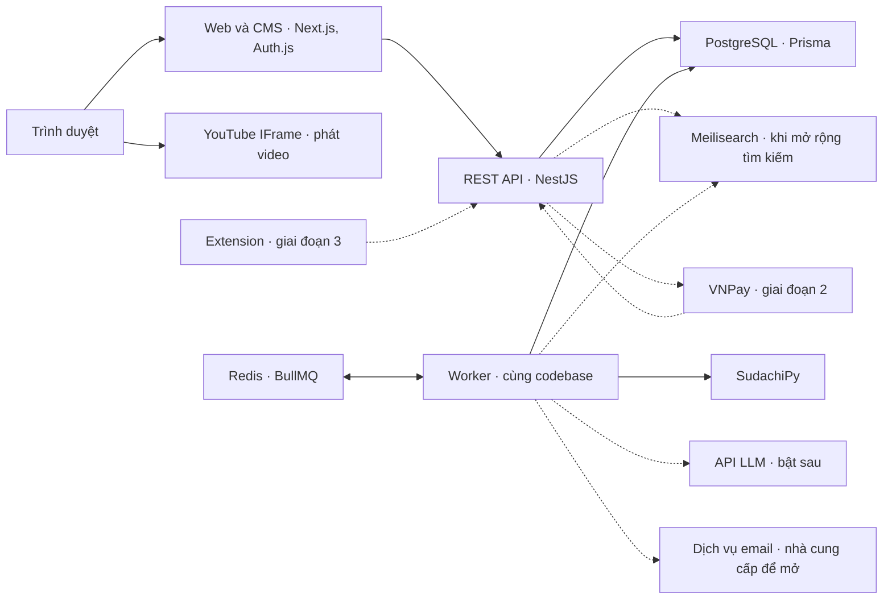
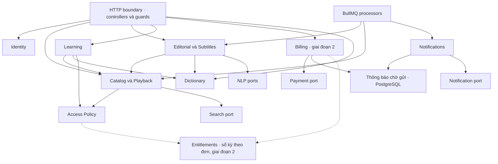
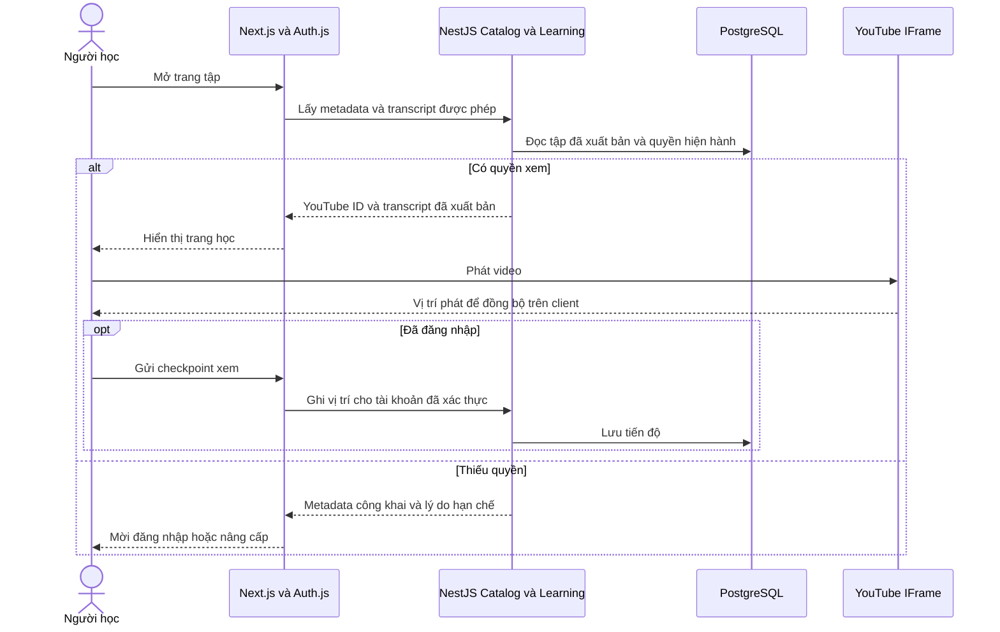
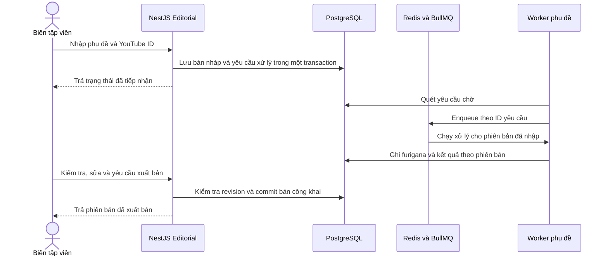
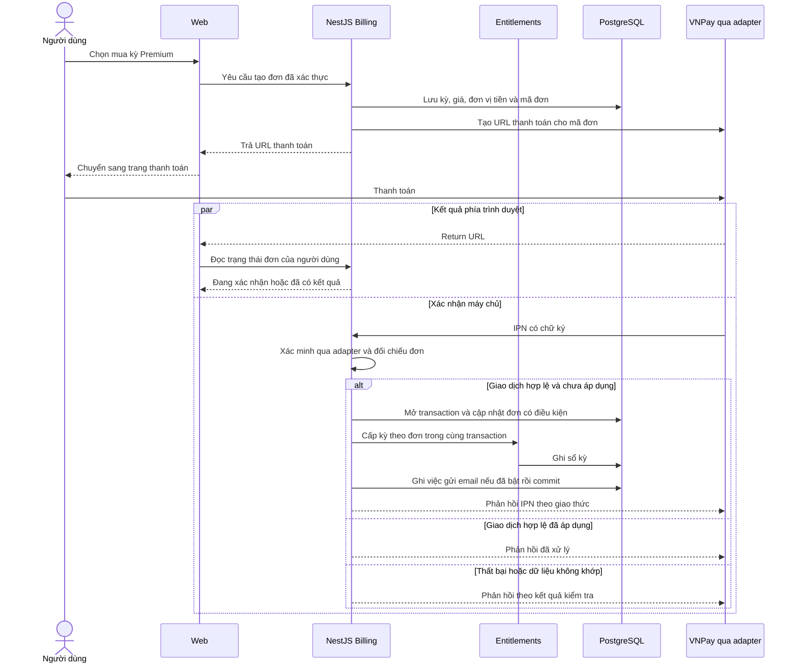

# Kiến trúc backend cho website học ngoại ngữ qua video

## 1. Tóm tắt

- Người học xem video YouTube cùng transcript Nhật–Việt, tra từ và lưu câu hoặc từ để học lại.
- Dùng **NestJS modular monolith**, một REST API và một worker BullMQ từ cùng codebase. PostgreSQL là nguồn dữ liệu chính.
- Next.js phụ trách web, CMS, SSR và phiên Auth.js. NestJS sở hữu phân quyền và nghiệp vụ dùng chung.
- MVP cho biên tập viên nhập, xử lý và xuất bản phụ đề. Worker sinh furigana trước, chừa điểm tích hợp AI để bật sau.
- Giai đoạn 2 bổ sung quyền theo gói, thanh toán từng kỳ và thông báo qua adapter. Giai đoạn 3 dùng lại API cho extension.

## 2. Yêu cầu và ràng buộc

| Nguồn | Phạm vi dùng cho thiết kế |
|---|---|
| PDF tr. 1–2, 5 | MVP gồm tài khoản, danh mục và tìm kiếm, xem video đồng bộ phụ đề, tra từ, lưu câu/từ và CMS. Phân tích câu, luyện tập, bảng học và gói trả phí thuộc giai đoạn 2. Giáo trình, extension, cộng đồng phụ đề và mở rộng ngôn ngữ thuộc giai đoạn 3. |
| PDF tr. 2–4, 6 | Một API, một cơ sở dữ liệu chính và worker phụ đề chạy riêng ngay từ đầu. Web phát video qua YouTube IFrame. Backend lưu dữ liệu học và phụ đề, không tải hoặc lưu video. |
| PDF tr. 3–4, 7 | NestJS REST/OpenAPI, PostgreSQL/Prisma, Redis/BullMQ, Meilisearch, Auth.js, SudachiPy hoặc MeCab + UniDic, JMdict/KANJIDIC, API LLM, Sentry/PostHog. Hạ tầng và cổng thanh toán chọn trong danh sách PDF. |
| Ràng buộc triển khai | Một người xây dựng và vận hành backend. AI dịch được triển khai sau, chuẩn bị ranh giới tích hợp ngay. Các chính sách nghiệp vụ bên dưới là đề xuất để review. |
| PDF tr. 5, 7 | 100 tập lúc beta và 1.000 người dùng hoạt động hằng tuần là mục tiêu kế hoạch. PDF chưa cung cấp tải đồng thời, SLA hay yêu cầu khôi phục dữ liệu. |

**MVP đề xuất.** Khách xem danh mục, metadata và các tập mẫu đã xuất bản. Đăng nhập để xem các tập thường, lưu câu/từ trong phạm vi được xem và đồng bộ “Xem tiếp”. Chỉ mở Google qua Auth.js lúc đầu. Đăng nhập email theo phạm vi PDF dùng magic link sau khi chốt dịch vụ gửi email. Dùng chung một vai trò biên tập viên cho nhập, sửa và xuất bản, ghi dấu ai đã thực hiện. Chọn SudachiPy. Đề xuất tìm tiêu đề series/tập/kênh trong PostgreSQL qua Search port ở beta, hoãn triển khai Meilisearch, tìm lời thoại và R2.

**Giai đoạn 2 đề xuất.** Free và Premium đều dùng được sổ tay và tiến độ với nội dung họ có quyền xem. Quyền xem lại mục đã lưu được kiểm tra tại thời điểm đọc. Phạm vi gói, kỳ bán và điều kiện hoàn tiền cần quyết định sản phẩm riêng. Thiết kế bên dưới dùng VNPay và mô hình mua từng kỳ làm phương án tích hợp đầu tiên.

**Phạm vi repo.** Tài liệu mô tả kiến trúc đích theo PDF. NestJS và Next.js là hai ứng dụng trong repo. Trước khi chuyển dữ liệu, kiểm kê tập nào có YouTube ID hợp lệ và phụ đề đủ quyền sử dụng, chạy thử import qua CMS trên staging và đối chiếu cue với bản gốc.

## 3. Sơ đồ tổng thể

*Sơ đồ trả lời câu hỏi mỗi thành phần chạy ở đâu và dữ liệu đi qua những hệ thống nào?*

Chạy một API và một worker với concurrency thấp ban đầu. Cấu hình triển khai đề xuất là Next.js trên Vercel, API và worker trên Railway, PostgreSQL quản lý trên Neon, đều là lựa chọn trong PDF. Đặt API, Redis và PostgreSQL gần nhau về vùng triển khai. Giữ Redis cho hàng đợi từ đầu. Chỉ dùng thêm cache khi đo được đường đọc cần tối ưu.

## 4. Module và lớp

*Sơ đồ trả lời câu hỏi module nào được gọi module nào và adapter bên ngoài nối vào đâu?*

Mũi tên giữa module biểu thị lời gọi qua interface được export. Entitlements là module nhỏ trong monolith, sở hữu sổ kỳ Premium và repository của mình. Billing sở hữu đơn và giao dịch, gọi lệnh cấp hoặc thu hồi kỳ qua interface của Entitlements trong cùng Prisma transaction. Hai module dùng repository riêng trong cùng phạm vi transaction. Access Policy gọi interface truy vấn quyền hiệu lực của Entitlements.

| Module | Trách nhiệm và phụ thuộc | Ranh giới |
|---|---|---|
| **Identity** | Sở hữu tài khoản, liên kết danh tính đăng nhập và vai trò ứng dụng. Tạo hoặc tra tài khoản khi nhận kết quả xác thực từ Next.js. | Vai trò biên tập viên độc lập với gói trả phí. Auth.js quản lý phiên, quyền ghi tài khoản thuộc NestJS. |
| **Catalog và Playback** | Sở hữu series, tập, YouTube ID, mức truy cập và phiên bản phụ đề đang công khai. Gọi Access Policy, dùng Search port để truy vấn danh mục. | Chỉ phục vụ dữ liệu được xuất bản và lọc lại các hit tìm kiếm theo PostgreSQL. Luồng xem không gọi LLM hoặc chạy xử lý phụ đề. |
| **Editorial và Subtitles** | Nhập SRT/VTT/JSON, chuẩn hóa cue, lưu bản nháp theo phiên bản, nhận kết quả NLP và điều phối xuất bản qua Catalog. Dùng BullMQ, NLP ports và Dictionary. | Worker chỉ ghi kết quả vào bản nháp đúng phiên bản đầu vào. Chỉ hành động của biên tập viên được phép mới xuất bản. |
| **Dictionary** | Tra cách đọc, nghĩa và kanji từ dữ liệu JMdict/KANJIDIC đã nhập, kèm nguồn. SudachiPy phục vụ tách từ và cách đọc trong pipeline. | Dictionary sở hữu dữ liệu tra cứu. Sổ tay và phân tích riêng theo ngữ cảnh nằm ở module khác. |
| **Learning** | Sở hữu bookmark và checkpoint theo tài khoản. Kiểm tra quyền nguồn khi lưu và khi mở lại qua Catalog/Access Policy. Từ điển độc lập được tra qua Dictionary. | Chỉ lưu tham chiếu cho nội dung theo tập. SRS dùng cùng quy tắc quyền đọc qua interface của Learning. |
| **Access Policy** | Quyết định theo trạng thái xuất bản, mức truy cập của tập, danh tính và quyền còn hiệu lực tại thời điểm đọc. | Không phụ thuộc SDK thanh toán. Mọi đường đọc transcript và các mục đã lưu dùng cùng chính sách khi truy cập lại nội dung. |
| **Billing** · giai đoạn 2 | Sở hữu đơn mua, xác nhận giao dịch, đối soát. Dùng Payment port và gọi Entitlements khi xác nhận mua hoặc hoàn. | Trình duyệt không thể kích hoạt quyền. Billing không ghi trực tiếp sổ kỳ, gửi email trực tiếp hay lưu dữ liệu thẻ. |
| **Entitlements** · giai đoạn 2 | Sở hữu sổ kỳ theo đơn, xử lý cấp/thu hồi và trả quyền hiện hành cho Access Policy. | Không gọi cổng thanh toán và không quyết định tập nào thuộc gói nào. |
| **Notifications** · triển khai theo nhu cầu | Nhận yêu cầu gửi từ bản ghi chờ xử lý, chọn mẫu và người nhận, chuyển cho Notification port. Dùng BullMQ để retry. | Lỗi gửi không đổi kết quả thanh toán hoặc quyết định xuất bản. |
| **Hạ tầng và entrypoint** | Prisma repository, BullMQ producer/processor và các adapter được nối tại bootstrap API/worker. | Không chứa quy tắc gói, xuất bản hay quyền truy cập. |

Trong mỗi module, **controller/processor** chuyển đầu vào thành lệnh và gọi use case. **Use case** kiểm tra quyền, điều phối nghiệp vụ và mở transaction khi cần. **Repository/adapter** thực hiện I/O. Dùng interface ở ranh giới module hoặc nơi có nhiều nhà cung cấp. Dùng Prisma qua repository của module sở hữu dữ liệu, tránh xuất repository để module khác ghi trực tiếp. API và worker có bootstrap riêng. Worker chỉ nạp các module cần để chạy job, kể cả khi dùng chung codebase.

**Định danh phụ đề.** Mỗi cue có `cueId` logic bất biến trong phạm vi tập. Nội dung và timing của cue được lưu theo `revisionId`. Sửa chữ, timing hoặc người nói giữ nguyên ID. Cue mới nhận ID mới. Khi tách, gộp hoặc import lại mà biên tập viên chưa xác nhận được ánh xạ, cấp ID mới và đánh dấu ID cũ đã ngừng dùng. Không dùng thứ tự hay timestamp để tự nối bookmark. Mở bookmark theo `episodeId + cueId` trên revision công khai hiện tại. Cue đã bỏ hoặc nội dung mất quyền hiện trạng thái không còn mở được và vẫn cho xóa bookmark. Checkpoint lưu `episodeId + positionMs` và không phụ thuộc cue.

**Dữ liệu trong sổ tay.** MVP lưu tham chiếu, không snapshot transcript, bản dịch, audio hoặc nghĩa theo ngữ cảnh tập. Bookmark từ điển độc lập giữ ID mục từ. Nếu bookmark có tham chiếu ngữ cảnh tập, chỉ trả phần đó sau khi kiểm tra quyền tập hiện hành. Dùng cùng quy tắc cho danh sách, ôn tập và mọi đường xuất dữ liệu học có nội dung theo tập.

## 5. Luồng dữ liệu chính

### 5.1. Xem tập và ghi tiến độ

*Sơ đồ trả lời câu hỏi quyền xem được kiểm tra ở đâu và ai đồng bộ video với phụ đề?*

Client lấy thời gian từ IFrame để tô sáng cue. Ghi checkpoint thưa theo đợt và khi pause hoặc kết thúc, dùng lần cập nhật hợp lệ mới nhất để hỗ trợ tua lùi. Metadata công khai có thể dùng cho SEO. Transcript cần quyền chỉ xuất hiện trong phản hồi riêng tư, tránh đưa vào HTML công khai hoặc cache dùng chung. Quyền trên website kiểm soát việc học cùng transcript. Video công khai trên YouTube vẫn có thể xem trực tiếp tại YouTube.

### 5.2. Nhập, xử lý và xuất bản phụ đề

*Sơ đồ trả lời câu hỏi bản nháp đi từ CMS qua worker thế nào trước khi người học nhìn thấy?*

Giới hạn kích thước và số cue khi nhận tệp. Lưu cue đã parse vào PostgreSQL để worker không cần đọc file tạm của API. **PostgreSQL là nguồn trạng thái duy nhất cho CMS và nghiệp vụ.** Redis/BullMQ chỉ giữ dữ liệu giao việc và retry. Bản ghi yêu cầu xử lý đóng vai trò outbox. Worker đưa việc chờ sang BullMQ theo job ID ổn định, rồi định kỳ đối chiếu yêu cầu chưa hoàn tất và phát lại nếu job đã mất. Processor ghi kết quả và trạng thái cuối trong cùng transaction, có kiểm tra revision và chống xử lý lặp. Khi bật Meilisearch, lưu yêu cầu cập nhật chỉ mục trong transaction xuất bản.

**Điều kiện xuất bản đề xuất.** Tất cả cue phải có nội dung nguồn, timing hợp lệ và bản dịch đã kiểm tra. NLP chỉ phục vụ làm giàu dữ liệu. Biên tập viên được xuất bản khi NLP đang chờ hoặc lỗi, với cảnh báo và hiển thị văn bản gốc ở cue thiếu furigana. Mỗi lần xuất bản chốt một revision công khai bất biến từ bản nháp, giữ các cue ID. Worker chỉ cập nhật bản nháp nếu phiên bản đầu vào còn khớp. Kết quả đến muộn chỉ lên trang học sau lần xuất bản tiếp theo.

Đặt `SubtitleDraftTranslator` tại bước xử lý bản nháp. MVP chạy tách từ/furigana và dùng bản dịch do biên tập viên nhập. Khi bật AI, lưu gợi ý gắn với phiên bản cue và kết quả từng bước. Không thay bản dịch đã duyệt. Khi thiếu kết quả ở một số cue, giữ các cue đó ở trạng thái cần xử lý lại. Phân tích ngữ pháp là use case riêng ở giai đoạn 2.

### 5.3. Mua kỳ Premium và xác nhận giao dịch

*Sơ đồ trả lời câu hỏi lúc nào người dùng được cấp Premium và nếu callback đến lặp thì hệ thống xử lý thế nào?*

Return URL chỉ phục vụ giao diện. IPN hợp lệ hoặc kết quả đối soát máy chủ đã xác minh mới được dùng để chốt đơn. Tạo đơn theo khóa idempotency của lần checkout để retry từ web trả lại cùng đơn. Đối chiếu chữ ký, định danh merchant, mã đơn, số tiền, đơn vị tiền theo cấu hình và trạng thái cổng. Dùng khóa duy nhất theo giao dịch provider và cập nhật đơn có điều kiện trong cùng transaction với quyền sử dụng. Tuần tự hóa các lần cộng kỳ cho cùng tài khoản. Khi IPN chậm hoặc mất, worker tra soát đơn chờ qua adapter. Nếu xác nhận đã thu tiền sau khi đơn hết hạn hoặc đã hủy, ghi trạng thái cần đối soát cho người vận hành quyết định cấp quyền hay hoàn tiền theo chính sách đã duyệt. [Tài liệu IPN và tra soát VNPay](https://sandbox.vnpayment.vn/apis/docs/faqs/)

**Mô hình quyền.** Một đơn mua cấp tối đa một kỳ. Sổ kỳ giữ thời lượng đã mua, khoảng hiệu lực, liên kết đơn và dấu vết thu hồi. Quyền tại thời điểm đọc được xác định từ các kỳ còn hiệu lực chưa bị thu hồi, theo khoảng `[bắt đầu, kết thúc)`. Một giá trị hết hạn tổng hợp chỉ là dữ liệu dẫn xuất. Khi cổng xác nhận hoàn, Billing yêu cầu Entitlements thu hồi đúng kỳ của đơn, giữ lịch sử và áp dụng chính sách đã duyệt cho các kỳ kế tiếp. Tính lại quyền trong cùng transaction và tuần tự hóa theo tài khoản. Ca review bắt buộc là hoàn kỳ ở giữa khi kỳ sau còn trong tương lai. Cần chốt kỳ sau giữ ngày hay dời lịch trước khi bật thanh toán.

**Quyết định sản phẩm tách riêng.** Giá, gói tháng/năm, cách nối kỳ, cách dời kỳ sau khi hoàn và điều kiện hoàn một phần do quyết định sản phẩm quy định. Tài liệu này chốt hình dạng dữ liệu và điểm áp dụng chính sách, còn các quyết định thương mại là điều kiện để mở bán.

## 6. Tích hợp bên thứ ba

- **Xác thực.** MVP dùng JWT session của Auth.js cho Google, không cấu hình adapter ghi tài khoản. Trong callback đăng nhập, Next.js gửi danh tính Google đã xác minh qua lời gọi HTTPS server-to-server. NestJS upsert theo khóa duy nhất `provider + subject`, trả ID tài khoản để Next.js gắn vào phiên. Nếu bước này lỗi, không phát phiên ứng dụng. Liên kết bằng email ở giai đoạn sau cần luồng xác minh riêng. NestJS là nơi duy nhất ghi dữ liệu tài khoản và sở hữu Prisma schema. [Auth.js Session Strategies](https://authjs.dev/concepts/session-strategies)
- **Truy cập từ web.** MVP giữ BFF cùng origin cho request đã đăng nhập. Next.js chuyển ID qua assertion ngắn hạn ký ở server, có issuer và audience riêng. NestJS xác minh assertion và tra trạng thái tài khoản, vai trò, quyền theo dữ liệu hiện hành. Next.js kiểm tra CSRF, giới hạn route chuyển tiếp và loại bỏ header nhận dạng từ trình duyệt. SSR gọi trực tiếp NestJS từ server. IPN đi thẳng tới NestJS và kiểm tra chữ ký của cổng. Phương án browser gọi trực tiếp bằng access token được so sánh ở mục 8.
- **Payment port.** Chuẩn hóa việc tạo checkout, xác minh thông báo từ cổng và tra trạng thái. Adapter chuyển payload và mã phản hồi của từng cổng sang kết quả nghiệp vụ. Chọn adapter từ cấu hình khi tạo đơn và giữ provider gốc trên đơn để tiếp tục đối soát sau khi đổi cổng. Điều kiện cấp quyền chỉ nằm trong Billing và Access Policy.
- **Notification port.** Nhận người nhận, nội dung đã render và khóa chống trùng theo sự kiện/người nhận. MVP hiển thị trạng thái job trong CMS. Khi có email, ưu tiên báo biên tập viên khi tập được xác nhận có lỗi nhúng và báo người mua sau khi xác nhận thanh toán. PDF chưa chọn dịch vụ gửi email, nên giữ adapter ở mức hợp đồng. Worker retry có giới hạn, lưu trạng thái gửi và dùng khóa idempotency phía nhà cung cấp nếu có. Với timeout mà chưa biết email đã gửi hay chưa, kiểm tra trạng thái trước khi gửi lại nếu provider hỗ trợ.
- **NLP ports.** Image worker đóng gói Python, SudachiPy và từ điển với phiên bản cố định. Mỗi worker khởi động một tiến trình con sống lâu, nạp từ điển một lần và chờ tín hiệu sẵn sàng. Dùng JSON Lines qua stdin/stdout, gắn ID yêu cầu, gửi tuần tự với concurrency 1 ban đầu và dành stderr cho log. Nếu timeout, tiến trình chết hoặc phản hồi sai định dạng, worker khởi động lại tiến trình con và cho BullMQ retry job trong giới hạn. Khi deploy, ngừng nhận job mới, chờ job đang chạy đến hết thời gian drain rồi đóng tiến trình con. LLM chạy qua adapter riêng khi bật.
- **Search port.** Beta dùng truy vấn chứa chuỗi trên metadata trong PostgreSQL, có phân trang và giới hạn độ dài truy vấn. Đo trước khi dùng `pg_trgm`. Extension này thuộc PostgreSQL nhưng cần xác nhận được phép bật trên môi trường triển khai. Meilisearch vẫn là lựa chọn theo PDF khi cần tìm lời thoại, chất lượng xếp hạng cao hơn hoặc tải tìm kiếm riêng.

## 7. Vận hành và debug

| Chủ đề | Cách làm và công cụ |
|---|---|
| **Log và định danh** | Dùng NestJS Logger ghi JSON với `service`, `module`, `operation`, `requestId`, `durationMs`, `errorCode`. Tạo hoặc xác thực request ID tại biên tin cậy, trả lại cho client và truyền qua Next.js, NestJS, outbox và BullMQ. Gắn thêm `jobId`, `episodeId`, `revisionId` hoặc `orderId` theo luồng. IPN có request ID riêng và liên kết checkout qua `orderId`. |
| **Lỗi HTTP và job** | Validation tại biên, lỗi nghiệp vụ có mã ổn định và exception filter chuyển thành status HTTP cùng thông báo an toàn. Dùng lỗi xung đột khi phiên bản đã đổi. BullMQ chỉ retry lỗi tạm thời với backoff. Tệp sai định dạng hoặc revision cũ kết thúc với lý do rõ ràng. Ẩn khóa, cookie, token, phụ đề thô và payload thanh toán khỏi log. |
| **Health checks** | Tách liveness của tiến trình và readiness của API với PostgreSQL. Báo riêng Redis, tuổi của job lâu nhất và tín hiệu worker. Redis tạm lỗi không làm mất yêu cầu nhập. Báo tình trạng Meilisearch riêng sau khi bật. Readiness không gọi LLM, YouTube hay VNPay trên mỗi lần kiểm tra. |
| **Theo dõi và khôi phục** | Sentry nhận lỗi API/worker và cảnh báo theo module. PostHog theo dõi hành vi học và funnel thanh toán, tránh gửi nội dung phụ đề hay dữ liệu thanh toán. Theo dõi lỗi theo bước NLP, tuổi outbox, job thất bại và đơn chờ xác nhận. Dùng staging để diễn tập khôi phục PostgreSQL và dựng lại chỉ mục khi đã bật. |
| **Rate limiting** | Dùng guard ở NestJS và giới hạn tại biên Next.js cho bắt đầu đăng nhập theo IP, theo địa chỉ email khi mở magic link. Tra từ giới hạn theo tài khoản hoặc IP với khách. Upload giới hạn theo biên tập viên, dung lượng, số cue và số job chưa xong. IPN có ngân sách riêng để chịu burst/retry, giới hạn trước các bước tốn tài nguyên và trả mã phản hồi theo hợp đồng VNPay. Luôn xác minh chữ ký. Dùng IP từ proxy tin cậy và Redis cho bộ đếm chia sẻ. Chốt ngưỡng từ staging và giới hạn cổng, tránh áp quota của web vào callback. |

Khi phụ đề chưa có sau import, bắt đầu ở CMS với `requestId` và trạng thái bản nháp. Nếu đã lưu nháp nhưng chưa có job, kiểm tra outbox và Redis. Nếu có job, tra `jobId` để phân biệt lỗi parser, SudachiPy và ghi kết quả. Nếu đã xuất bản nhưng không thấy qua tìm kiếm, kiểm tra điều kiện lọc của Catalog, rồi kiểm tra độ trễ chỉ mục nếu đã bật Meilisearch.

**Migration và thứ tự deploy.** Dùng một Prisma schema và một lịch sử migration. CI chạy bước apply migration production của phiên bản Prisma đã ghim, đúng một lần cho mỗi lần triển khai, trước khi đổi runtime. Thêm schema tương thích với API và worker cũ trước. Sau đó deploy worker đọc được job cũ và mới, rồi deploy API phát job mới. Giữ phiên bản trong payload job, backfill theo lô và kiểm tra không còn tiến trình, job hoặc bản rollback phụ thuộc schema cũ trước khi xóa dữ liệu/cột cũ ở release sau. Nếu cần rollback, quay lại runtime tương thích và giữ schema đã mở rộng. [Prisma về áp dụng migration](https://www.prisma.io/docs/orm/migrations/applying-a-migration)

**Hợp đồng API và kiểm tra module trong CI.** Dùng `/api/v1` và xuất OpenAPI từ NestJS. Trong một major, ưu tiên thêm trường tùy chọn và giữ nghĩa, kiểu của trường hiện có. Thay đổi phá vỡ tương thích mở version mới chạy song song. Trước khi ngừng version cũ, theo dõi client còn dùng và thông báo thời hạn hỗ trợ. CI kiểm tra diff OpenAPI với bản phát hành trước và cấm import nội bộ xuyên module bằng quy tắc ESLint trên các entrypoint public và đường dẫn import, gồm cả alias và đường dẫn tương đối. Quy tắc kiểm thử phải bắt được import repository từ module khác. Đây là công cụ lint trong CI, không thêm runtime.

**Xóa tài khoản.** Identity khóa truy cập ngay khi tiếp nhận yêu cầu. NestJS kiểm tra trạng thái này kể cả khi cookie Auth.js vẫn còn hiệu lực, và luồng upsert đăng nhập không mở lại tài khoản đang xóa. Các module xóa dữ liệu qua interface của mình, với job có thể chạy lại an toàn. Learning xóa bookmark và checkpoint. Notifications hủy yêu cầu gửi đang chờ. Entitlements kết thúc quyền sử dụng. Billing giữ riêng hồ sơ giao dịch tối thiểu cần cho đối soát và lưu giữ bắt buộc, tách khỏi hồ sơ học. Dùng định danh lưu giữ riêng và xóa liên kết có thể bỏ được. Callback đến muộn vẫn có thể đối soát giao dịch nhưng không cấp quyền cho tài khoản đã khóa hoặc đã xóa. Chốt thời hạn lưu, dữ liệu tối thiểu và xử lý backup trước khi ra mắt thu phí.

## 8. Quyết định kiến trúc

| Quyết định | Trạng thái | Lý do | Phương án đã cân nhắc |
|---|---|---|---|
| **NestJS API, Next.js web** | Đề xuất | Tách hợp đồng API khỏi vòng đời frontend và dùng chung nghiệp vụ cho web, CMS, worker và extension. [NestJS Modules](https://docs.nestjs.com/modules) | Route Handlers làm toàn bộ backend giảm một runtime HTTP nhưng vẫn cần worker riêng. [Next.js Backend for Frontend](https://nextjs.org/docs/app/guides/backend-for-frontend) |
| **BFF cho web trong MVP** | Đề xuất | Giữ cookie phiên cùng origin và assertion ở phía server. Chấp nhận thêm hop và chi phí chuyển payload qua Vercel, đo p95 và kích thước transcript/upload trên staging. | Browser gọi NestJS trực tiếp bằng access token ngắn hạn do server cấp sau khi xác minh phiên. Giảm hop và cho phép extension dùng lại hợp đồng token, nhưng extension vẫn cần luồng đăng nhập riêng. Khi chuyển, giữ token trong bộ nhớ, định nghĩa refresh, giới hạn CORS theo origin, giữ cookie phiên ở Next.js và dùng bearer tới NestJS. |
| **Một DB chính, một worker riêng** | Đã chốt theo PDF | PostgreSQL sở hữu trạng thái nghiệp vụ, BullMQ giao việc. [NestJS Queues](https://docs.nestjs.com/techniques/queues) | Chạy NLP trong request hoặc chia thành nhiều service làm tăng độ trễ hay khối lượng vận hành. |
| **AI triển khai sau** | Đã chốt phạm vi | Giữ adapter ở pipeline nháp để chi phí và lỗi AI nằm ở luồng biên tập. | Dịch theo lượt xem hoặc buộc AI chạy xong trước khi xuất bản. |
| **Cue ID ổn định, bookmark tham chiếu** | Đề xuất | Sửa timing và text vẫn giữ bookmark. Quyền đọc dựa trên tập hiện tại. | ID theo revision cần migration bookmark. Snapshot có nguy cơ lộ nội dung khi mất quyền. |
| **Google trước, email magic link sau** | Đề xuất | Giảm số luồng xác thực lúc beta. Identity là nơi duy nhất ghi tài khoản. | Bật cả hai ngay, hoặc tự vận hành mật khẩu và khôi phục. |
| **Tìm catalog trong PostgreSQL lúc beta** | Đề xuất | Giảm một dịch vụ có trạng thái ở quy mô khoảng 100 tập. Search port giữ đường chuyển sang Meilisearch theo PDF. | Chạy Meilisearch từ beta để có chất lượng tìm kiếm tốt hơn, đổi lại cần triển khai, đồng bộ và giám sát chỉ mục sớm. |
| **Một cổng và sổ kỳ theo đơn** | Đề xuất | Theo dõi được từng lần cấp hoặc thu hồi quyền mà vẫn commit cùng thanh toán. | Một cột hết hạn làm mất nguồn gốc quyền. Đa cổng và tự gia hạn sớm tăng tải đối soát. |

## 9. Đường mở rộng

| Tín hiệu | Thay đổi tiếp theo |
|---|---|
| API đọc tập chậm hoặc PostgreSQL tăng tải | Xem kế hoạch truy vấn, chỉnh index và kích thước phản hồi trước. Sau đó cache metadata công khai hoặc dữ liệu theo phiên bản, với kiểm tra quyền trước khi trả transcript. Tăng replica API khi chính runtime API là nút thắt. |
| Tuổi hàng đợi nhập tăng trong nhiều đợt hoặc NLP chiếm CPU | Tách queue NLP và queue gửi/đối soát. Chạy thêm worker từ cùng codebase và tăng concurrency theo giới hạn CPU/API bên ngoài. Giữ hợp đồng job theo phiên bản. |
| Truy vấn catalog vượt mục tiêu độ trễ hoặc người học cần tìm lời thoại | Đo truy vấn PostgreSQL và cân nhắc `pg_trgm` nếu được phép. Chuyển Search port sang Meilisearch khi cần xếp hạng tốt hơn hoặc index lời thoại. Giữ khả năng dựng lại từ PostgreSQL và kiểm tra quyền trước khi trả nội dung. |
| Hop BFF hoặc payload là nút thắt, hoặc bắt đầu extension | Thử luồng access token ngắn hạn với một client, kiểm tra CORS và đăng nhập/thu hồi. Giữ REST/OpenAPI và các use case dùng chung. |
| Có ghi âm shadowing hoặc ảnh biên tập cần quản lý | Bổ sung adapter R2 theo PDF, có vòng đời tệp và quyền truy cập. |
| Thêm SRS, giáo trình hoặc extension | Thêm module nghiệp vụ dùng interface công khai của Learning và Catalog. Extension dùng lại REST/OpenAPI và chính sách quyền hiện có sau khi chốt cơ chế đăng nhập. Chỉ tách thành service riêng khi một module cần lịch triển khai hoặc tài nguyên độc lập lâu dài. |

## 10. Rủi ro và câu hỏi còn mở

- **YouTube và quyền sử dụng nội dung.** Video có thể bị gỡ hoặc chặn nhúng. Cần chốt nguồn kiểm tra trạng thái đáng tin cậy, tiêu chí ẩn tập và cách nhận khiếu nại trước khi tự động ẩn. Tạm thời CMS cho biên tập viên xác nhận và gỡ xuất bản. PDF yêu cầu rà soát quyền video/phụ đề trước khi thu phí.
- **Quyền xem khi ra mắt trả phí.** Cần duyệt phạm vi tập mẫu, Free và Premium, tiêu chí chuyển tập từ Free sang Premium và mức preview trước đăng nhập. Bookmark mất quyền vẫn giữ tham chiếu theo mục 4.
- **Thanh toán.** Cần chốt giá, quy tắc ngày cuối kỳ, xử lý đơn đến muộn và việc hoàn tiền ảnh hưởng thế nào đến các kỳ đã nối tiếp. Xác nhận quy trình vận hành, quyền thực hiện hoàn và kịch bản sandbox VNPay trước khi nhận giao dịch thật.
- **Email, NLP và dữ liệu.** Cần chọn nhà cung cấp email và LLM, giới hạn dữ liệu gửi ra ngoài và quy tắc liên kết tài khoản Google với email khi mở magic link. Đo chất lượng nghĩa tiếng Việt và cách ghi nguồn từ điển theo yêu cầu trong PDF.
- **Hạ tầng và khôi phục.** Xác nhận vùng triển khai, hỗ trợ runtime SudachiPy của worker, cách quản lý Redis/Meilisearch và mục tiêu mất dữ liệu/thời gian khôi phục. PDF đưa mốc beta và chi phí ước tính, nên kế hoạch một người cần đo thời gian nhập và duyệt tập trên staging trước khi cam kết.
- **Giai đoạn 3.** Bilibili xuất hiện trong mô tả tham chiếu nhưng bảng tính năng chỉ nêu YouTube/Netflix. Chốt danh sách nền tảng, mô hình cấp quyền extension và quy trình kiểm duyệt cộng đồng trước khi thiết kế chi tiết.
