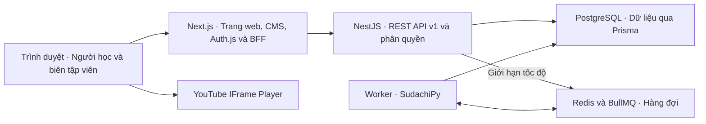

# Hướng triển khai MVP để bàn với nhóm Frontend

MVP giúp người Việt học tiếng Nhật qua video YouTube có phụ đề Nhật–Việt. Luồng người học là mở danh mục, chọn tập, xem phụ đề đồng bộ, tra từ và lưu nội dung vào Sổ tay. Luồng biên tập là tạo tập, nhập phụ đề, sửa bản dịch, gán người nói, duyệt và xuất bản.

Tài liệu ghi nhận cách hệ thống đang chạy trong repo để nhóm FE có thể thử và phản hồi. Các mục **Có trong repo** là hành vi hiện tại. Mục **Cần chốt với FE** là đề xuất cho buổi trao đổi.

## 1. Kiến trúc và cách ghép FE với BE

*Sơ đồ trả lời ứng dụng nào phục vụ giao diện, kiểm tra quyền, lưu dữ liệu và xử lý phụ đề.*

- [`backend/`](../backend/README.md) là backend chính. NestJS sở hữu API, phân quyền, nghiệp vụ và schema Prisma. API và worker là hai tiến trình của cùng codebase. PostgreSQL là nơi lưu dữ liệu và trạng thái xử lý, còn Redis/BullMQ dùng để giao việc cho worker.
- [`frontend/`](../frontend/README.md) có giao diện tham chiếu chạy được cho danh mục, tài khoản, Sổ tay và CMS. Trình xem tham chiếu đi qua BFF tại `/api/v1/preview?episode=<id>`. [Mã trình xem](../backend/viewer/player.js)
- **Browser gọi API tương đối cùng origin**, ví dụ `fetch('/api/v1/episodes?page=1')`. Auth.js đọc cookie phiên ở Next.js. BFF là lớp Next.js chuyển tiếp các route được phép và gửi xác nhận ngắn hạn tới NestJS. Với SSR, server Next.js có thể dùng `backendFetch` sau khi đọc phiên. Khóa và token nội bộ nằm ở server. [BFF](../frontend/app/api/v1/%5B...path%5D/route.ts) · [Client server-to-server](../frontend/lib/backend.ts)

## 2. Các luồng đã có trong repo

| Hạng mục | Hành vi hiện tại | Phần FE cần nối |
| --- | --- | --- |
| **Tài khoản** | Google OAuth qua Auth.js. Đăng nhập lần đầu tạo tài khoản `LEARNER`. Có hồ sơ, tên hiển thị, trình độ N5–N1, ngôn ngữ học `ja` và luồng xóa tài khoản. | Nút đăng nhập/đăng xuất, màn hình hồ sơ và xác nhận xóa. Dùng vai trò từ hồ sơ để hiện link CMS. NestJS kiểm tra quyền cho mỗi thao tác. |
| **Kho nội dung** | Danh mục công khai chỉ gồm tập đã xuất bản. Tìm theo tên tập, series hoặc kênh. Lọc kết hợp theo series, trình độ, thể loại và kênh. | Giữ bộ lọc trong URL. Khi đổi bộ lọc, về trang 1. Hiển thị trạng thái rỗng và nhãn tập mẫu hoặc tập cần đăng nhập. |
| **Trình xem học tập** | Có video YouTube, transcript đồng bộ, bấm câu để tua, lặp câu, đổi tốc độ và ẩn/hiện bản dịch. | Dùng YouTube IFrame Player và đồng hồ của player để xác định câu đang phát. Hiển thị transcript kể cả khi YouTube không phát được. |
| **Furigana và tra từ** | Worker SudachiPy tách từ, sinh furigana và lưu dạng từ điển. Tra JMdict/KANJIDIC2, ưu tiên nghĩa Việt đã duyệt, dùng nghĩa Anh có nhãn khi thiếu. | Render ruby, cho bấm cả từ và tra thủ công. Hiển thị cách đọc, nghĩa và kanji liên quan. Transcript cũ có thể thiếu dữ liệu tách từ. |
| **Lưu câu, lưu từ và xem tiếp** | Có lưu/bỏ lưu tại chỗ, đọc trạng thái nút tim theo lô, Sổ tay có phân trang và lưu vị trí xem. | Hiện trạng thái theo tài khoản. Sau khi tải lại, đọc trạng thái từ API. Mục câu hết quyền xem hoặc bị bỏ vẫn xuất hiện với trạng thái không còn mở được và có thể xóa. |
| **CMS nội dung** | Có tạo kênh/series, đặt metadata lọc, tạo tập bằng YouTube ID, nhập SRT/VTT/JSON, sửa bản dịch, gán người nói, duyệt và gỡ xuất bản. Có tìm tập theo tiêu đề và phân trang. | Có thể dùng `/editorial` hiện tại để nhập nội dung và demo. Nếu thay UI CMS, dùng lại quy tắc revision, kiểm tra bản dịch và quyền `EDITOR`. |

### Quyền truy cập cần thể hiện đúng

| Trạng thái | Danh mục đã xuất bản | Xem tập `SAMPLE` | Xem tập `MEMBER` | Hồ sơ và Sổ tay cá nhân | CMS |
| --- | --- | --- | --- | --- | --- |
| Khách | Có | Có | Yêu cầu đăng nhập | Yêu cầu đăng nhập | Yêu cầu đăng nhập |
| `LEARNER` đang hoạt động | Có | Có | Có | Có | Không có quyền |
| `EDITOR` đang hoạt động | Có | Có | Có | Có | Có |

`MEMBER` hiện là tập cần đăng nhập. Tập chưa xuất bản hoặc đã gỡ biến mất khỏi danh mục. Trang học và Sổ tay đọc dữ liệu phụ đề theo quyền hiện hành.

## 3. API để FE thử tích hợp

Các đường dẫn dưới đây dùng tiền tố `/api/v1` trên cùng origin với Next.js. Đây là API hiện có để FE đối chiếu và phản hồi. [OpenAPI và hướng dẫn chạy API](../backend/README.md#chạy-cục-bộ)

### Tài khoản và kho nội dung

| API | Cách dùng |
| --- | --- |
| `GET /identity/me` | Trả `{ id, role, displayName, jlptLevel, learningLanguage }`. `displayName` và `jlptLevel` có thể là `null`. |
| `PATCH /identity/me` | Gửi `displayName`, `jlptLevel` hoặc cả hai. Tên tối đa 80 ký tự, trình độ từ N5 đến N1. Gửi `null` để xóa giá trị. `learningLanguage` hiện cố định là `ja`. |
| `DELETE /identity/me` | Vô hiệu hóa tài khoản và xóa liên kết Google, thông tin hồ sơ có thể chỉnh, bookmark và tiến độ. Sau `204`, giao diện gọi luồng đăng xuất Auth.js và về danh mục. |
| `GET /episodes?q=...&page=1&series=...&level=N4&genre=...&channelId=...` | Trả `{ episodes, page, hasMore }`, 20 tập mỗi trang. Các tiêu chí kết hợp theo AND. `series` dùng slug, `channelId` dùng UUID. Bỏ tham số của bộ lọc chưa chọn. Danh sách chỉ trả metadata. |
| `GET /episodes/filters` | Trả `{ levels, genres, channels }` với `channels` là danh sách `{ id, name }`. Các lựa chọn dựa trên tập đã xuất bản, độc lập với bộ lọc đang chọn. |
| `GET /series` | Trả danh sách series có tập đã xuất bản. Dùng `slug` để lọc tập và `title` để hiển thị. |

Trình độ và thể loại của tập lấy từ series. Tập thuộc series dùng kênh của series, còn tập lẻ dùng kênh được gán trực tiếp. Metadata có thể trống nếu biên tập viên chưa điền.

### Trình xem, từ điển và Sổ tay

| API | Cách dùng |
| --- | --- |
| `GET /episodes/:episodeId` | Trả `{ id, title, youtubeId, revisionId, cues }`. Mỗi cue có `id`, `startMs`, `endMs`, `text`, `translation`. `speakerId`, `speaker`, `ruby` và `words` là tùy chọn. `401` khi khách mở tập `MEMBER`, `404` khi không có bản xuất bản. |
| `GET /dictionary?q=食べる&surface=食べました` | Trả `{ entries, kanji }`. Mỗi mục có `id`, `headword`, `readings` và `glosses` với `lang`, `text` và `source` nếu có. Tra `lemma` trước rồi thử `surface` khi cần. Tra thủ công chỉ gửi `q`. |
| `GET /learning/bookmarks/status?episodeId=...` hoặc `?entryId=...&entryId=...` | Trả `{ keys }` của tài khoản trong phiên. Mỗi request dùng một chế độ. Tối đa 32 `entryId` mỗi lần, phù hợp cho một lượt tra từ. |
| `POST /learning/bookmarks` | Gửi `{ episodeId, cueId }` để lưu câu hoặc `{ entryId }` để lưu từ. Trả `{ key }`. |
| `DELETE /learning/bookmarks/:key` | Encode nguyên `key` bằng `encodeURIComponent` khi ghép URL. Thành công trả `204`. |
| `GET /learning/bookmarks?page=1` | Trả `{ items, page, hasMore }`, 25 mục mỗi trang. Xét `available` trước khi render nội dung câu. |
| `GET /learning/checkpoints/:episodeId` và `PUT /learning/checkpoints/:episodeId` | Đọc `{ checkpoint }` với giá trị có thể là `null`. Gửi `{ positionMs }` để cập nhật. `GET /learning/checkpoints` trả tối đa 5 tập xem tiếp trong `items`. |

- **Timing và ID.** Backend dùng mili giây, YouTube player dùng giây. Khi mở từ Sổ tay, tua đến `cue.startMs` trên revision hiện hành. Dùng `cue.id` từ API làm `cueId` cho bookmark. Bookmark câu có khóa `cue:<episodeId>:<cueId>`, bookmark từ có khóa `word:<entryId>`.
- **Dữ liệu furigana.** `ruby` chứa các cặp `[surface, reading]` với `reading` có thể là `null`. Khi có `words`, mỗi phần tử giữ `surface`, `lemma`, `reading` và các đoạn `ruby` để hiển thị và tra cả từ. Với phụ đề cũ, dùng `ruby` hoặc `text` và giữ ô tra thủ công.
- **Trạng thái UI.** Tải tim câu một lần khi mở tập và tim từ theo lô sau khi có kết quả tra. Chặn thao tác lặp trong lúc lưu/bỏ lưu. Hủy hoặc bỏ qua kết quả tra cũ khi đổi từ khóa. Khi tải tim lỗi, cho thử lại và vẫn hiển thị phụ đề hoặc kết quả tra.
- **Xem tiếp.** Trình xem tham chiếu lưu khoảng 15 giây một lần khi đang phát và khi tạm dừng hoặc kết thúc. Tua đến câu cụ thể từ Sổ tay được ưu tiên trước gợi ý xem tiếp.

### CMS và vòng đời bản nháp

| API | Cách dùng |
| --- | --- |
| `GET /editorial/episodes?page=1&q=...` | Tìm tập theo tiêu đề và trả `{ episodes, page, hasMore }`, 25 tập mỗi trang. Có cả tập chưa xuất bản. |
| `POST /editorial/episodes` | Tạo tập từ `title`, `youtubeId` và phân nhóm nếu có. Tập mới mặc định `MEMBER`. |
| `GET/POST /editorial/channels`, `GET/POST /editorial/series`, `PATCH /editorial/series/:seriesId` | Tạo kênh/series và sửa `level`, `genre`, `channelId` của series. |
| `PUT /editorial/episodes/:id/grouping`, `GET/POST /editorial/episodes/:id/speakers` | Gán phân nhóm tập, tạo và đọc danh sách người nói của tập. |
| `GET/PUT /editorial/episodes/:id/draft` | Đọc bản nháp hoặc gửi `{ expectedDraftId, format, content }`. Lần nhập đầu dùng `expectedDraftId: null`. SRT/VTT gửi chuỗi. JSON gửi object `{ cues }`. Tệp được đọc ở browser và gửi dưới dạng JSON qua BFF. |
| `POST /editorial/episodes/:id/publish` | Gửi `{ draftId, reviewed: true }`. Tất cả câu cần có bản dịch. Có thể xuất bản khi NLP đang chờ hoặc lỗi. Hiện cảnh báo vì tập có thể thiếu furigana. |
| `PUT /editorial/episodes/:id/visibility`, `DELETE /editorial/episodes/:id/publication` | Đổi `SAMPLE`/`MEMBER` hoặc gỡ xuất bản. Gỡ xuất bản vẫn giữ bản nháp. |

Khi sửa bản dịch hoặc người nói, giữ `id` của cue và gửi `expectedDraftId` của bản đã tải. Nếu gặp `409 REVISION_CONFLICT`, giữ nội dung người dùng đang sửa và cho tải lại sau khi đối chiếu. SRT/VTT nhập lại sẽ tạo cue ID mới. Muốn sửa câu gốc hoặc timing mà giữ bookmark, dùng JSON bản nháp và giữ ID các câu tương ứng. Worker xử lý trên bản nháp. Khi NLP chuyển sang `READY` sau một lần xuất bản, biên tập viên xuất bản lại để đưa furigana lên trình xem. [CMS hiện tại](../frontend/app/editorial/episode-editor.tsx)

### Lỗi, cache và dữ liệu riêng

- `400` là đầu vào không hợp lệ, `401` cần đăng nhập lại, `403` thiếu quyền hoặc origin không hợp lệ, `404` là nội dung không còn truy cập được hoặc route không có. CMS xử lý thêm `409` xung đột và `422` chưa đủ điều kiện xuất bản.
- Qua BFF, các thao tác ghi cần đúng origin của `AUTH_URL`. `POST`, `PATCH` và `PUT` gửi `Content-Type: application/json`. Giới hạn body là 1 MiB, tính cả phần JSON bao ngoài. Khi gặp `413`, báo tệp hoặc nội dung quá lớn.
- Với `429`, dùng `Retry-After` nếu có. Hạn mức hiện tại mỗi phút là 12 lần bắt đầu đăng nhập mỗi IP, 30 lượt tra từ mỗi IP khách, 90 lượt tra từ mỗi tài khoản và 15 lần ghi bản nháp mỗi biên tập viên.
- Lỗi API dùng `error.code` và `error.message`. Khi báo lỗi cho BE, ghi kèm `x-request-id` nếu phản hồi có. Giữ `private, no-store` khi tích hợp các đường đọc transcript, hồ sơ, bookmark và tiến độ qua BFF hoặc SSR. [Xử lý lỗi](../backend/src/http.ts) · [BFF](../frontend/app/api/v1/%5B...path%5D/route.ts)

## 4. Môi trường, dữ liệu và phạm vi

- **Local.** PostgreSQL và Redis chạy bằng Docker Compose, NestJS mặc định cổng 3001 và Next.js cổng 3000. Chạy migration trước khi khởi động API/worker. Cấu hình OAuth Google với callback local `http://localhost:3000/api/auth/callback/google`. Để thử CMS, đăng nhập lần đầu rồi nhờ BE cấp `EDITOR` theo ID tài khoản. [Chạy BE](../backend/README.md#chạy-cục-bộ) · [Chạy web](../frontend/README.md#chạy-cục-bộ) · [Schema và migration](database.md)
- **CI và staging.** Workflow GitHub Actions trong repo build NestJS và Next.js, kiểm tra migration trên PostgreSQL tạm và chạy smoke test API → Redis → worker. Đợt kiểm tra CMS gần nhất đã chạy thêm Chromium qua BFF trên DB tạm. Cần xác nhận URL, OAuth callback, môi trường dữ liệu riêng và tài khoản thử trước khi dùng staging làm mốc nghiệm thu chung. [Workflow CI](../.github/workflows/ci.yml)
- **Khi đưa lên môi trường chung.** Nếu còn API cũ từ bước 2, tắt đường truy cập đó trước khi áp quyền `MEMBER`. Kiểm tra quyền xem và cache qua BFF với cả khách lẫn người đã đăng nhập sau deploy hoặc rollback. Với DB đã có dữ liệu, theo quy trình cutover riêng cho migration chuẩn hóa phụ đề. [API nội dung](../backend/README.md#biên-tập-và-danh-mục) · [Quy trình migration](database.md)
- **Dữ liệu nội dung.** Nhóm sẽ chuẩn bị video/phụ đề có quyền sử dụng và CSV nghĩa Việt đã duyệt nếu có. Có thể demo bằng dữ liệu tạm. Mốc 100 tập là mục tiêu nội dung trong kế hoạch beta, cần tách khỏi việc tích hợp FE/BE. Một lô demo nên có tập `SAMPLE`, tập `MEMBER`, phụ đề đã xử lý NLP và mục từ có hoặc chưa có nghĩa Việt.
- **Đã chốt cho đợt hiện tại.** Chỉ cấu hình đăng nhập Google và tạm hoãn đăng nhập email. Dữ liệu mẫu chính thức để sau. Ưu tiên đưa các luồng MVP đã có vào giao diện nhóm. AI dịch, thanh toán, thông báo, extension, flashcard và tìm trong lời thoại nằm ngoài đợt tích hợp này. [Kiến trúc backend](backend-architecture.md)

## 5. Cần chốt với FE

Phân công đề xuất cho buổi ghép. FE phụ trách màn hình, điều hướng, trạng thái UI và điều khiển YouTube player. BE phụ trách API, phân quyền, lưu dữ liệu và luồng xử lý phụ đề. Hai bên chạy thử cùng một lô dữ liệu và đối chiếu theo từng màn hình.

1. **Cách ghép code.** Nhóm FE phát triển trực tiếp trên `frontend` hay ghép UI từ repo khác. Chốt vị trí giữ Auth.js/BFF, origin khi chạy chung và đường dẫn cuối của trang xem, tài khoản, Sổ tay và CMS. Đề xuất demo đầu dùng chung origin với Next.js hiện tại.
2. **Thứ tự tích hợp.** Đề xuất nối **Danh mục → Trình xem**, sau đó **Google → hồ sơ → quyền xem**, rồi **Tra từ → Sổ tay → xem tiếp**. Dùng CMS hiện tại để chuẩn bị nội dung trong khi FE làm luồng học. Chốt CMS có cần thay UI ngay trong MVP hay dùng bản hiện tại cho nhóm biên tập.
3. **Hành vi giao diện và API.** Chốt điều hướng sau khi đăng nhập, thông báo khi tập đã gỡ, cách thể hiện nghĩa Việt/Anh và trạng thái tim khi lỗi. Với mỗi màn hình, FE chỉ ra field hoặc trạng thái còn thiếu. BE cập nhật API và ví dụ nếu hai bên thống nhất đổi hợp đồng.
4. **Môi trường và đầu mối.** Chốt ai cấu hình Google OAuth, ai giữ dữ liệu staging, ai nhập phụ đề và kiểm duyệt nghĩa Việt. Xác định phạm vi demo nội bộ và phạm vi công bố MVP trước khi cam kết số tập.

**Nghiệm thu buổi tích hợp đề xuất.** Khách lọc danh mục, xem được tập mẫu và được mời đăng nhập khi mở tập `MEMBER`. Người học đăng nhập Google, xem tập `MEMBER`, bấm câu để tua, tra và lưu từ, tải lại vẫn thấy tim đã bật. Biên tập viên nhập phụ đề, sửa bản dịch, gán người nói và xuất bản lại với cùng cue ID. Bookmark mở đúng câu hiện hành. Khi gỡ xuất bản, tập biến mất khỏi danh mục và bookmark cũ vẫn xóa được.
