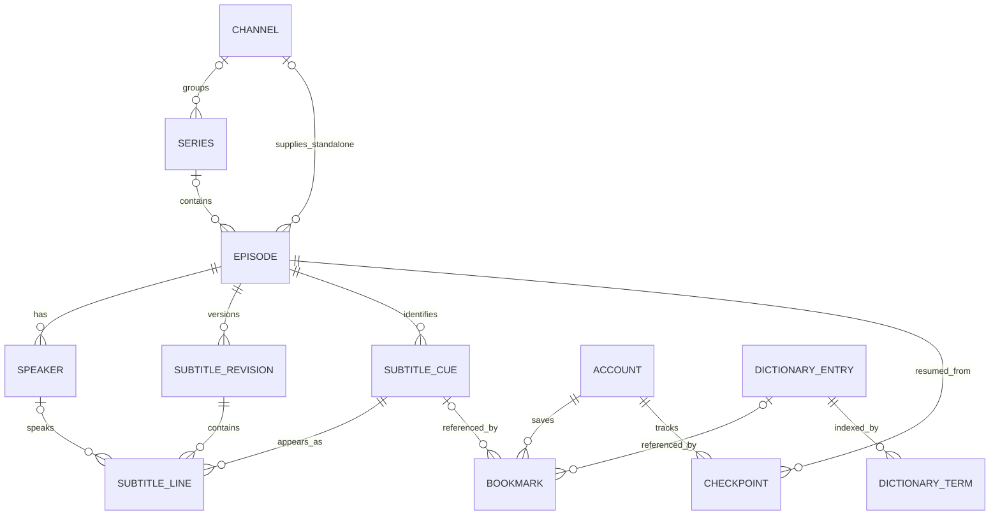

# Cơ sở dữ liệu backend

Schema nguồn nằm trong [Prisma schema](../backend/prisma/schema.prisma). Backend dùng PostgreSQL và Prisma. Mô hình MVP bám theo phần thiết kế dữ liệu ở trang 4–5 của PDF. Local dùng PostgreSQL Docker. Supabase sẽ được cấu hình riêng khi nhóm có môi trường chung.

## Bảng MVP

| Thực thể trong PDF | Bảng PostgreSQL | Nội dung và ràng buộc chính |
|---|---|---|
| User | `accounts` | ID nội bộ, liên kết Google, vai trò, trạng thái vô hiệu hóa và hồ sơ người học. Tên tự đặt và trình độ JLPT là tùy chọn, ngôn ngữ học mặc định `ja`. Auth.js giữ phiên, NestJS sở hữu tài khoản. |
| Channel | `channels` | Tên kênh duy nhất, nguồn YouTube và ảnh tùy chọn. |
| Series | `series` | Tên, slug duy nhất, mô tả, ngôn ngữ, trình độ, thể loại và kênh tùy chọn. |
| Episode | `episodes` | YouTube ID, tiêu đề, series, số tập, thời lượng nếu biết, phạm vi xem và revision hiện hành. Số tập duy nhất trong một series. Tập lẻ có thể gắn trực tiếp với kênh. |
| Speaker | `speakers` | Tên, màu và avatar tùy chọn. Tên duy nhất trong một tập. |
| SubtitleLine | `subtitle_lines` | Mỗi dòng là một cue trong một revision, có `start_ms`, `end_ms`, câu Nhật, `translation_vi` và `tokens` JSONB. Index `(episode_id, start_ms)` hỗ trợ truy vấn theo thời gian. |
| DictionaryEntry | `dictionary_entries`, `dictionary_terms` | ID nguồn JMdict/KANJIDIC2, cách viết, cách đọc, nghĩa và chỉ mục tra chính xác. |
| SavedItem | `bookmarks` | Mỗi tài khoản lưu một tham chiếu đến cue của tập hoặc mục từ. Có ràng buộc đảm bảo mỗi hàng chỉ có một loại tham chiếu. |
| WatchProgress | `checkpoints` | Một vị trí xem theo mili giây cho mỗi cặp tài khoản và tập. |

`subtitle_revisions` giữ lịch sử nháp và các bản đã xuất bản, cùng trạng thái NLP. `subtitle_cues` giữ định danh ổn định của cue qua các revision. `smoke_results` phục vụ kiểm tra hạ tầng. `LineAnalysis`, `ReviewCard`, `Subscription` và `Contributor` sẽ được thêm cùng các tính năng tương ứng.

*Sơ đồ cho thấy series, tập, phụ đề và dữ liệu học liên kết với nhau ở đâu.*



## Phụ đề và tính nhất quán

- `cueId` nhận diện cùng một câu trong phạm vi một tập. Khóa của dòng phụ đề là `(revisionId, cueId)`. ID trong API giữ nguyên khi chỉnh nội dung hoặc timing của cue đó. Cơ sở dữ liệu kiểm tra revision, cue và người nói đều thuộc đúng tập.
- CMS nhập hoặc lưu chỉnh sửa thành bản nháp mới. Worker chỉ cập nhật `tokens` trên bản nháp còn hiện hành. API xuất bản sao chép các dòng sang revision riêng và đổi con trỏ `published_id` trong cùng giao dịch. Trang xem đọc đúng bản đã xuất bản.
- `tokens` hiện lưu các cặp mặt chữ và furigana. API tiếp tục trả mảng `cues` với `id`, `startMs`, `endMs`, `text`, `translation`, `ruby` khi có, và thông tin người nói khi được gán.
- Bookmark tra cue trên revision công khai hiện tại. Nếu bỏ cue hoặc gỡ tập, bookmark vẫn có thể xóa nhưng không trả nội dung phụ đề. Tiến độ xem không phụ thuộc cue.

## Chuyển đổi dữ liệu local

Migration [pdf_catalog_subtitle_lines](../backend/prisma/migrations/20261110040000_pdf_catalog_subtitle_lines/migration.sql) bổ sung bảng và backfill trong một transaction.

1. Tạo kênh từ nhãn cũ và gom series theo cặp tên series/kênh giống nhau sau khi bỏ khoảng trắng đầu cuối. Slug của nhóm cũ được tạo ổn định. Tập không có series vẫn là tập lẻ. Số tập và thời lượng chưa có dữ liệu được để trống.
2. Tách mọi cue trong revision cũ thành dòng, giữ ID, thứ tự, timing, câu Nhật, bản dịch và furigana. Nếu cue cũ không có trường người nói riêng, không suy diễn từ nội dung câu.
3. Giữ cột JSONB `subtitle_revisions.cues` và hai cột nhãn cũ để đối chiếu lịch sử. API và worker mới dùng bảng chuẩn hóa cho dữ liệu mới. Sau khi phát sinh bản ghi mới, chạy lại binary cũ sẽ không đọc đủ dữ liệu. Khi cần quay lại, khôi phục bản sao trước migration hoặc lập chuyển đổi ngược có kiểm tra cho các ghi mới.

Lần đối chiếu dữ liệu local ngay sau migration giữ nguyên **7 tập, 19 revision và 232.152 mục từ điển**. **19 cue** từ JSONB khớp với **19 dòng** sau khi so từng giá trị. DB local chưa có bookmark hay checkpoint. Trên bản sao thử nghiệm, mình đã tạo hai loại bản ghi trước migration rồi xác nhận API vẫn đọc được sau migration. Kiểm tra tích hợp cũng xác nhận bookmark mở đúng câu sau khi xuất bản lại, checkpoint giữ nguyên và gỡ xuất bản làm bookmark ngừng trả nội dung.

## Chạy local

Từ `backend`, tạo `.env` từ `.env.example` và giữ cấu hình PostgreSQL local. Trước khi áp migration này lên DB đã có dữ liệu, sao lưu DB và dừng API/worker phiên bản cũ. Có thể giữ PostgreSQL và Redis đang chạy.

```sh
docker compose up -d --wait
npm ci
npm run build
npm run db:migrate:deploy
npm run db:migrate:status
```

Khởi động worker mới rồi API mới theo [README backend](../backend/README.md). Hai runtime cần cùng phiên bản ở lần chuyển kho phụ đề này. Payload BullMQ vẫn giữ revision ID và phiên bản hiện hành. Job đang chờ đọc dữ liệu đã backfill khi worker mới chạy.

CMS có thể tạo kênh, tạo series, gán tập vào series và tạo người nói. Gán `speakerId` trong JSON cue để hiển thị tên ở trình xem. Danh mục có `GET /api/v1/series` và lọc theo slug qua `GET /api/v1/episodes?series=<slug>`. Chỉ series có tập đã xuất bản xuất hiện trong danh mục công khai.

Bộ seed 3 series, 12 tập trong slide chưa có trong repo này. Dùng YouTube ID và phụ đề đã được nhóm xác nhận khi nhập dữ liệu demo. Hướng dẫn cấu hình web nằm trong [README Next.js](../frontend/README.md).
